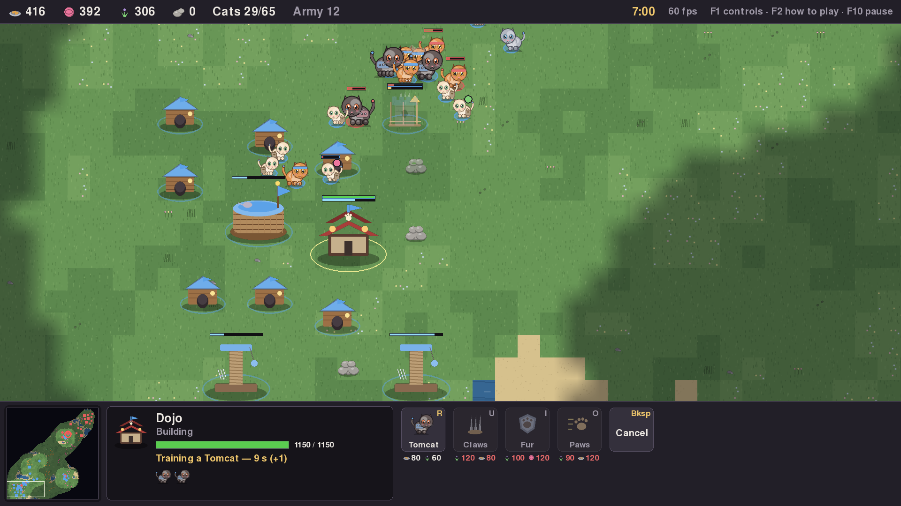
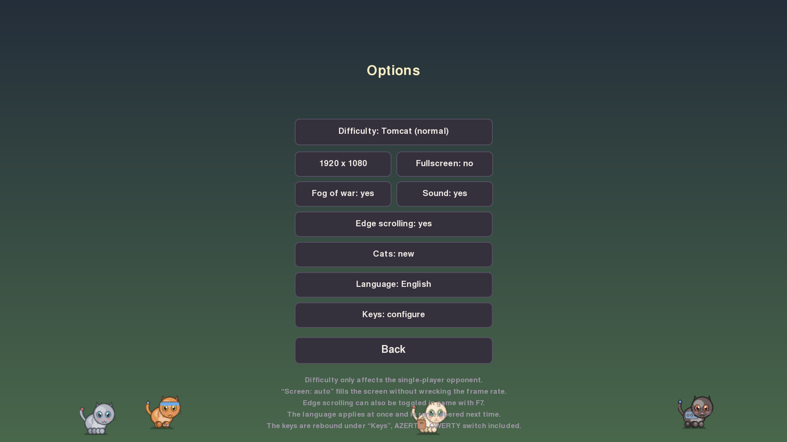
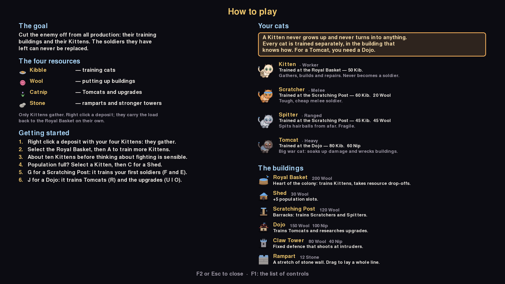
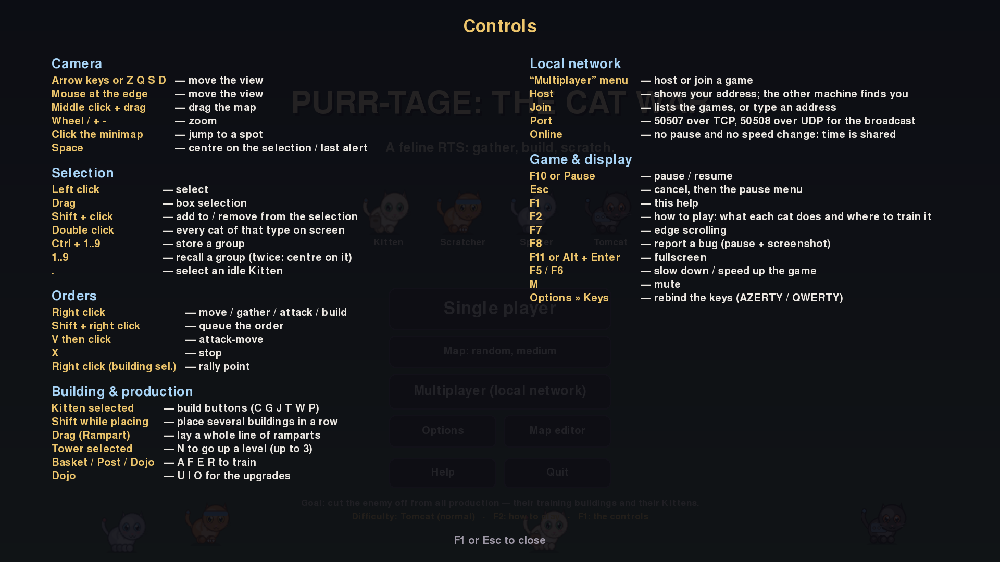

# Purr-tage: The Cat War 🐾

[Français](README.md) · **English**

*Purr-tage : La Guerre des Chats* in French. A **real-time strategy** game in
the vein of *Age of Empires*… except with cats.
Written in Python with pygame, **without a single image or sound file**: every
sprite is drawn by the code and every sound effect is synthesised on the fly.

The full list of features — economy, units, combat, the AI opponent, maps, the
editor, multiplayer, interface and tooling — is in
[docs/fonctionnalites.en.md](docs/fonctionnalites.en.md).



> **A developer?** Installing from source, the architecture, the tests and
> building the packages all live in [README-dev.en.md](README-dev.en.md).

---

## Installation

### To play (with nothing else to install)

The packages are built automatically and attached to the
[published releases](https://github.com/RosePounce/purr-tage/releases):

| System | File | What to do |
|---|---|---|
| Windows | `Purrtage-x.y.z-installeur.exe` | double-click, follow the wizard |
| Linux | `Purrtage-x.y.z-x86_64.AppImage` | make it executable (`chmod +x`) then run it |

No Python and no pygame to install: everything is in the package. The Windows
installer does not ask for administrator rights and adds a Start menu
shortcut, along with its uninstaller.

> **Firewall** — the first time you host a networked game, Windows will ask
> for permission for the game. Accept it for **private networks**, otherwise
> the other machine will not see you.

Bug reports and saves go into your home directory — `%APPDATA%\Purrtage` on
Windows, `~/.local/share/purrtage` on Linux — never into the install folder,
which is read-only.

### To develop

The game also runs from the sources, in two commands: the steps, the
command-line options and the rest of the tooling are in
[README-dev.en.md](README-dev.en.md#installing-from-source).

### The screens

The main menu offers **Play solo**, the choice of **Map**, **Multiplayer
(local network)**, **Options**, **Map editor**, **Help** and **Quit**. One
click on the **Map** button (a right click goes backwards) steps through a
random map at each size — small (64 x 64), medium (96 x 96), large
(128 x 128), very large (160 x 160) — then through the maps saved in the
editor. The choice holds for solo and network games alike. Every other
setting — difficulty, resolution, fullscreen, fog, sound, edge scrolling,
**cat style** and language — lives in **Options**. The **Cats** setting
switches between the new, rounder look and the classic one (cats seen in
profile); like the language, the choice is remembered from one launch to the
next.



### Resolution and fullscreen

The game adapts to any window size: the panel, the fonts and the sprites are
all resized together, from 1280x760 up to 2880x1800.

- **F11** or **Alt + Enter** toggles fullscreen at any moment, even in the
  middle of a game.
- The menu offers a **Screen** button (1280x760 → 2880x1800, or *auto*) and a
  **Fullscreen** button.
- The window can be freely resized with the mouse.

In *auto* fullscreen, rendering is capped at 1200 pixels high and SDL then
scales the image up on the GPU: the screen is filled entirely without
collapsing the frame rate. That is exactly what is needed on a high-density
display such as 2880x1800, whose "logical" resolution is half of that anyway.
For a genuinely native rendering, ask for it explicitly:

```bash
python main.py --resolution 2880x1800 --fullscreen
```

The sprites are **regenerated** at the chosen scale (x1, x1.5 or x2) rather
than enlarged: the cats stay crisp, since they are drawn from shapes and not
read from an image.

---

## Languages

The game speaks French and English. On the first launch it follows the system
language; the **Language** button on the options screen switches it live —
including mid-game — and remembers the choice for next time. On the command
line, `--language en` (or `--langue en`) overrides it without remembering
anything.

The identifiers in the code are English — `kitten`, `basket`, `kibble` — and
never change: `purrtage/settings.py`, the saves and the network messages all
rest on them. Only their labels are translated, a `kitten` showing up as
"Chaton" in French and *Kitten* in English.

Adding a language means copying a JSON file and translating it: the steps are
in [README-dev.en.md](README-dev.en.md#adding-a-language).

## The map editor

**Map editor**, from the main menu, opens a blank map, all grass, with both
bases in their usual spots. On it you paint:

* the terrain — **water**, **sand**, **grass**, **meadow**, **flowers** — with
  a round brush of 1, 3, 5 or 9 tiles;
* the resources — **kibble**, **wool**, **catnip**, **stone** — one tile per click, or a
  trail by dragging the mouse;
* the two starting **bases**, placed or moved with a click;
* the **eraser** removes the resources under the brush.

| | |
|---|---|
| **Left click** / **drag** | apply the chosen tool |
| **Right click** | remove the resources under the brush |
| **1** to **0**, **Delete** | pick one of the first ten tools, the eraser |
| Keypad `+` / `-`, **PgUp** / **PgDn** | brush size |
| **Ctrl + wheel** on a resource | change its amount, in steps of 20 |
| **Wheel**, wheel held down, **arrows**, minimap | zoom and scrolling |
| **Ctrl + Z** | undo |
| **Ctrl + S** | save |
| **Escape** | back to the menu |

The bottom panel also offers **New** (blank map) and **Random** (generated
map) at the size picked with **Size**, **Open** to resume a saved map, and
**Undo**. The name is typed by clicking the field at the top left; it also
names the file. Covering a resource with water removes it, and a resource can
be placed neither on water nor under a base.

A map is only saved when it can be played: two bases on dry land, with no
resource under them, not overlapping, and joined by a path on foot. Maps go
into `saves/maps/`, next to the bug reports, in the binary `.pmap` format: a
few kilobytes, even for a very large map. Leaving or opening another map with
unsaved changes asks for a second click.

## Playing head to head on a local network

Two computers, two players, no split screen.

1. On the first machine: **Multiplayer (local network)** → **Host a game**.
   The screen shows its address.
2. On the second one: **Multiplayer (local network)** → **Join a game**. The
   hosted game appears in the list all by itself — the host advertises over
   UDP broadcast. When the network blocks broadcast, **Enter an address** lets
   you type the one the host displays.
3. The game starts on both sides at the same time. No AI: both sides are
   human.

The map is the one the host picked in the menu. A random map is grown again
on the other side from its seed and its size; a map from the editor travels
whole inside the start message: the guest does not need to have it. That
change to the start message moves the network protocol to version 2: a 1.0
build and a recent one refuse to play together, with a message saying so.

Ports used: **50507 over TCP** (the game) and **50508 over UDP** (the
advertisement). Those are the only ones to allow should a firewall get
involved.

Over the network, pausing and the speed setting are disabled: time is shared
between the two players.

The details of **lockstep** — turns, order delay, the simulation fingerprint
and desync detection — are in
[README-dev.en.md](README-dev.en.md#how-the-game-stays-in-sync).

## The idea

You lead the **Whisker Clan**. Across the map, the **Chartreux Horde** does
exactly the same thing, without cheating: same economy, same costs, same
units. It gathers, builds, upgrades its troops and launches ever bigger
assault waves.

**You win once your opponent can no longer produce anything**: no recruiting
building left standing *and* no kitten left to rebuild one. No need to hunt
down the last cat lost at the other end of the map.

### The four resources

| Resource | Gathered from | Mostly used for |
|---|---|---|
| 🥫 **Kibble** | bowls | recruiting cats |
| 🧶 **Wool** | balls of yarn | putting up buildings |
| 🌿 **Catnip** | flowering patches | tomcats and upgrades |
| **Stone** | heaps of stones | ramparts and tower levels |

Kittens carry 12 units at a time and bring them back to the nearest **Royal
Basket**. A node depletes and shrinks as it goes.

### The cats

| Unit | Role | Cost | What is special |
|---|---|---|---|
| **Kitten** | worker | 50 🥫 | gathers, builds, repairs |
| **Scratcher** | melee | 60 🥫 · 20 🧶 | tough and cheap |
| **Spitter** | ranged | 45 🥫 · 45 🧶 | long-range hairballs, fragile |
| **Tomcat** | heavy | 80 🥫 · 60 🌿 | soaks up damage, and x1.8 against buildings |

### The buildings

| Building | Cost | Role |
|---|---|---|
| **Royal Basket** | 200 🧶 | trains kittens, takes resource drop-offs, +10 slots |
| **Shed** | 30 🧶 | +5 population slots |
| **Scratching Post** | 120 🧶 | trains scratchers and spitters |
| **Dojo** | 150 🧶 · 100 🌿 | trains tomcats, researches upgrades |
| **Claw Tower** | 80 🧶 · 40 🌿 | fixed defence that shoots on its own |
| **Rampart** | 12 stone | one tile of wall; drag to lay a whole line |

### The upgrades (at the Dojo)

* **Sharpened Claws** — +5 attack for every unit
* **Thick Fur** — +2 armour and +15% hit points
* **Quick Paws** — +20% movement speed

### The levels of the Claw Tower

A finished tower is strengthened where it stands: select it, then **N**. It
keeps shooting during the works, and **Backspace** cancels them and gives the
resources back.

| Level | Cost | Time | Gain |
|---|---|---|---|
| **2** | 80 stone · 40 🌿 | 22 s | +7 attack, +1 tile of range, +350 HP |
| **3** | 150 stone · 80 🌿 | 30 s | +9 attack, +1 tile of range, +450 HP |

---

## How to play

The game carries its own explanation page: **F2**, from the menu as well as
during a game.



One point is worth stating right away, because it misled a tester: **a kitten
does not grow up and never turns into a soldier.** Each cat is recruited
separately, in the building that knows how to do it — a scratcher at the
scratching post, a tomcat at the dojo. The kittens, for their part, gather,
build and repair for the whole game.

---

## Controls



| | |
|---|---|
| **Arrows**, mouse at the edge, middle-click drag | move the camera |
| **Wheel**, `+` / `-` | zoom (4 levels) |
| **Left click** / **drag** | select / rectangle selection |
| **Shift + click** | add to or remove from the selection |
| **Double click** | every cat of the same type visible on screen |
| **Right click** | contextual order: go, gather, build, attack |
| **Shift + right click** | queue the order |
| **V** then click | attack-move |
| **X** | stop |
| **Ctrl + 1…9** / **1…9** | store / recall a group (2x = center on it) |
| **.** | select an idle kitten |
| **Space** | center on the selection or on the last alert |
| **P C G J T W** | place basket, shed, scratching post, dojo, tower, rampart (kitten selected) |
| **A F E R** | recruit kitten, scratcher, spitter, tomcat |
| **U I O** | start an upgrade at the dojo |
| **N** | take the selected tower up one level |
| **Z Q S D** | move the camera, like the arrow keys |
| **F10** or **Pause** | pause / resume |
| **F7** | turn edge scrolling on / off |
| **F8** | report a bug (pause + screenshot) |
| **F11** or **Alt + Enter** | fullscreen |
| **F2** | how to play: what the cats do and how to recruit them |
| **F1** · **Esc** · **F5/F6** · **M** | controls · cancel · speed · sound |

Tip: hold **Shift** while placing a building to chain several in a row. A
**rampart** is laid by dragging: press on the first tile, release on the last,
and the whole line becomes a building site, as far as your stone goes. The
selected kittens share out the segments and move on to the next ones by
themselves.

Moving the mouse over a node gives it a **halo** and shows what it still
holds. **Edge scrolling** is switched off with **F7** or from the menu, and
`--no-edge-scroll` disables it from the launch.

A cat sent on the attack **chains onto the next enemy** once its target is
down, instead of stopping. It pursues much further on an explicit order than
on a plain retaliation, so that a garrison does not let itself be lured away.


Those are **the shipped keys, drawn on an AZERTY keyboard**. Every one of them
can be changed under **Options → Keys**, which offers an **AZERTY / QWERTY**
switch in one click as well as key-by-key rebinding. The choice is remembered
between launches, and the **F1** page always shows the keys actually in use.

A key does one thing only: giving it to an action takes it from the one that
had it. That is why the scratcher sits on `F` and the dojo on `J`: `Z` and `D`
belong to the camera. The arrows, the zoom keys, the function keys, Escape,
the digits and the modifiers (Shift, Ctrl, Alt) cannot be assigned.

Why it is needed: SDL resolves a key by the character it *produces*, not by
where it sits. On a QWERTY board the `A Z E R` row scatters — `a` lands on the
home row, `z` at the bottom left — and the four cats are no longer under the
fingers.

---

## Reporting a bug

**F8** pauses the game and opens a report window. Describe what you saw,
**Enter** sends it, **Esc** cancels.

The report goes into `saves/bug/`, next to the launch folder:

```
saves/bug/bogue_20261004-174016.txt
saves/bug/bogue_20261004-174016.png
```

The text file holds your description, then everything needed to reproduce it:
Python and pygame versions, system, resolution and scale, map seed,
difficulty, play time, camera position, resources and headcount of both sides,
upgrades, the current selection and the last messages displayed. The
screenshot shows the screen as it was at the moment of the report, panel
included; the **Attach a screenshot** box (or **Tab**) leaves it out.

### Sending

The installed game also sends the report to the game's team, with no account
to create and no file to look for: the window reads "Sent to the game's team.
Thank you!". Without a connection, the report waits in `saves/bug/outbox/`
and goes out on the next launch. It holds nothing personal, and a copy always
stays on the computer; the **Open the folder** button leads there.

The game only talks to a relay, a Cloudflare Worker described in
[`relay/`](relay/README.en.md), which then forwards to GitHub, Discord or by
e-mail. Its configuration and the send log are in
[README-dev.en.md](README-dev.en.md#sending-bug-reports).

---

## Licence

**GNU General Public License v3.0 or later** (GPL-3.0-or-later) — full text
in [LICENSE](LICENSE).

Copyright © 2026 RosePounce.

You are free to use, study, modify and redistribute this game, including
commercially. In return, any modified version or derivative work must stay
under the same licence and be distributed with its sources. This is therefore
not "royalty-free": the code cannot be closed up inside proprietary software.

### The game's resources

There is no asset to credit, because there is none: the sprites are drawn by
`purrtage/sprites.py`, the sound effects synthesised by `purrtage/audio.py`,
the package icon generated by `packaging/make_icon.py`, and the captures in
`docs/` are screenshots of the game. All of it is covered by the GPL above.

The one exception is the **display font**: the game asks for pygame's default
font (`freesansbold.ttf`, from GNU FreeFont), which is not versioned here but
which PyInstaller bundles into the packages. It is under the GPL with a font
exception, with no crediting requirement.

### Redistributed dependencies

| Component | Licence |
|---|---|
| pygame / pygame-ce | LGPL 2.1 |
| SDL2, SDL2_ttf (via pygame) | zlib / MIT |
| AppImage runtime (Linux package) | MIT |

All are compatible with distribution under GPLv3.
