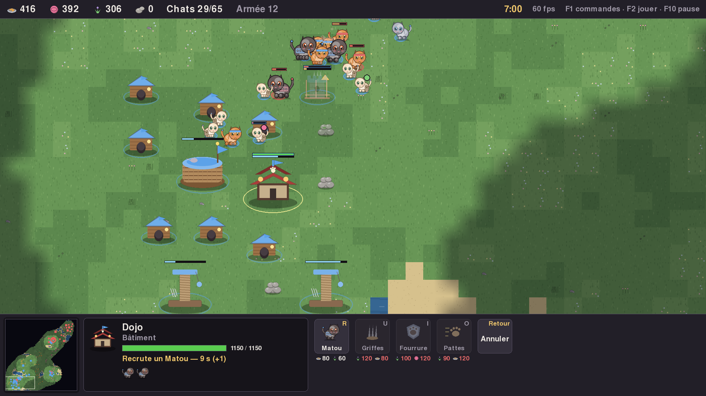
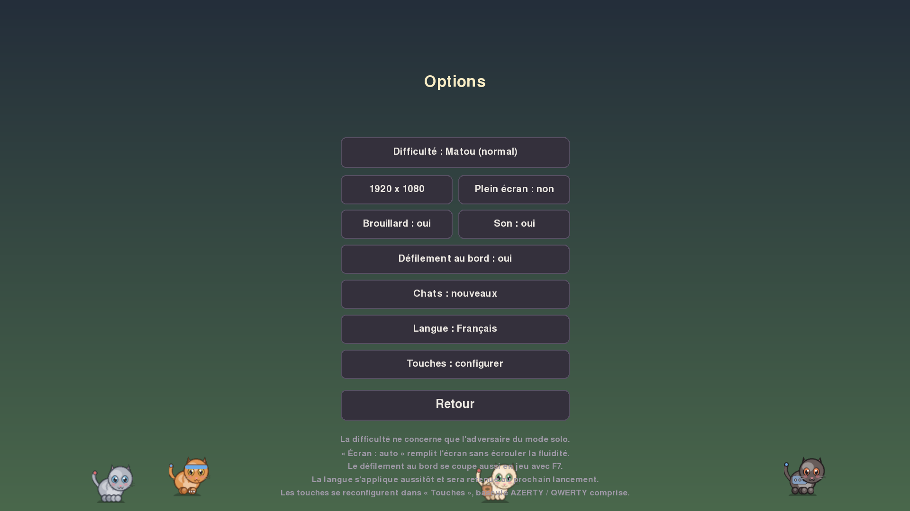
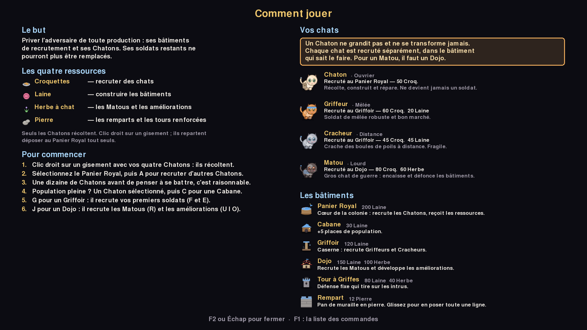
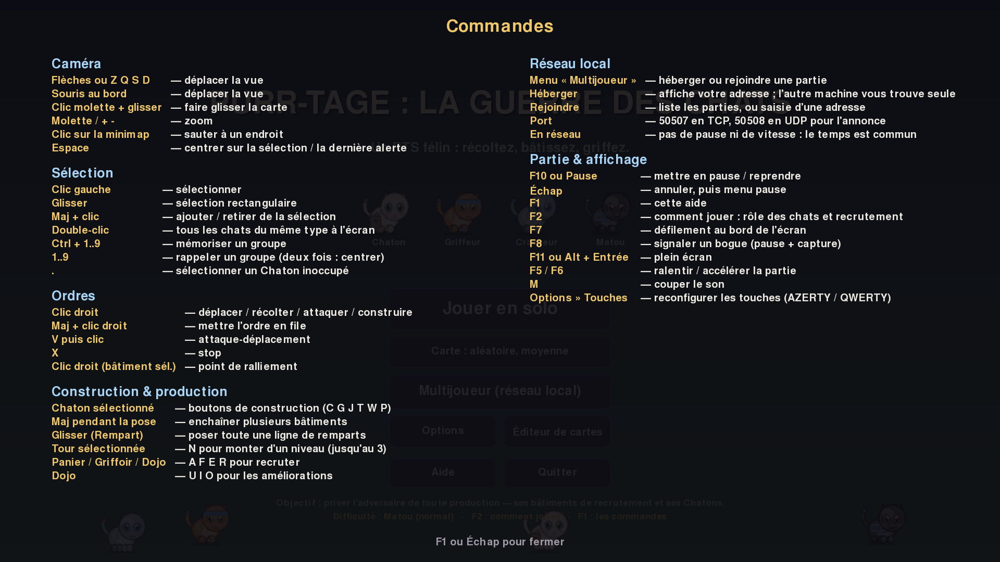

# Purr-tage : La Guerre des Chats 🐾

**Français** · [English](README.en.md)

*Purr-tage: The Cat War* en anglais. Un jeu de **stratégie en temps réel**
façon *Age of Empires*… mais entre chats.
Écrit en Python avec pygame, **sans aucun fichier d'image ou de son** : tous les
sprites sont dessinés par le code et tous les bruitages sont synthétisés à la
volée.

La liste complète des fonctionnalités — économie, unités, combat, adversaire
IA, carte, éditeur, multijoueur, interface et outils — est dans
[docs/fonctionnalites.md](docs/fonctionnalites.md).



> **Développeur ?** L'installation depuis les sources, l'architecture, les
> tests et la construction des paquets sont dans
> [README-dev.md](README-dev.md).

---

## Installation

### Pour jouer (sans rien installer d'autre)

Les paquets sont construits automatiquement et attachés aux
[versions publiées](https://github.com/RosePounce/purr-tage/releases) :

| Système | Fichier | Ce qu'il faut faire |
|---|---|---|
| Windows | `Purrtage-x.y.z-installeur.exe` | double-cliquer, suivre l'assistant |
| Linux | `Purrtage-x.y.z-x86_64.AppImage` | rendre exécutable (`chmod +x`) puis lancer |

Ni Python ni pygame à installer : tout est dans le paquet. L'installeur
Windows ne demande pas les droits administrateur et ajoute un raccourci au
menu Démarrer, avec son désinstalleur.

> **Pare-feu** — au premier hébergement d'une partie en réseau, Windows
> demandera l'autorisation pour le jeu. Acceptez pour les **réseaux privés**,
> sinon l'autre machine ne vous verra pas.

Les rapports de bogue et les sauvegardes vont dans votre dossier personnel —
`%APPDATA%\Purrtage` sous Windows, `~/.local/share/purrtage` sous Linux —
jamais dans le dossier d'installation, qui est en lecture seule.

### Pour développer

Le jeu se lance aussi depuis les sources, en deux commandes : la marche à
suivre, les options de la ligne de commande et le reste de l'outillage sont
dans [README-dev.md](README-dev.md#installation-depuis-les-sources).

### Les écrans

Le menu principal propose **Jouer en solo**, le choix de la **Carte**,
**Multijoueur (réseau local)**, **Options**, **Éditeur de cartes**, **Aide** et
**Quitter**. Le bouton **Carte** fait défiler, d'un clic (clic droit pour
revenir en arrière), une carte aléatoire de chaque taille — petite (64 x 64),
moyenne (96 x 96), grande (128 x 128), très grande (160 x 160) — puis les
cartes enregistrées dans l'éditeur. Ce choix vaut pour le solo comme pour le
réseau. Tous les autres réglages — difficulté, résolution, plein écran,
brouillard, son, défilement au bord, **style des chats** et langue — vivent
dans **Options**. Le réglage **Chats** bascule entre le nouveau look, tout en
rondeurs, et l'ancien (chats vus de profil) ; comme la langue, le choix est
retenu d'un lancement à l'autre.



### Résolution et plein écran

Le jeu s'adapte à n'importe quelle taille de fenêtre : le panneau, les polices
et les sprites sont redimensionnés ensemble, de 1280×760 à 2880×1800.

- **F11** ou **Alt + Entrée** bascule en plein écran à tout moment, même en
  pleine partie.
- Le menu propose un bouton **Écran** (1280×760 → 2880×1800, ou *auto*) et un
  bouton **Plein écran**.
- La fenêtre est librement redimensionnable à la souris.

En plein écran *auto*, le rendu est plafonné à 1200 pixels de haut et SDL
agrandit ensuite l'image sur le GPU : l'écran est entièrement rempli sans
effondrer le nombre d'images par seconde. C'est exactement ce qu'il faut sur un
écran haute densité type 2880×1800, dont la résolution « logique » est de toute
façon la moitié. Pour un rendu réellement natif, demandez-le explicitement :

```bash
python main.py --resolution 2880x1800 --fullscreen
```

Les sprites sont **regénérés** à l'échelle choisie (×1, ×1,5 ou ×2) plutôt
qu'agrandis : les chats restent nets, puisqu'ils sont dessinés à partir de
formes et non lus depuis une image.

---

## Langues

Le jeu parle français et anglais. Au premier lancement il suit la langue du
système ; le bouton **Langue** de l'écran des options en change à chaud — y
compris en pleine partie — et retient le choix pour la fois suivante. En ligne
de commande, `--language en` (ou `--langue en`) passe outre sans rien retenir.

Les identifiants du code sont en anglais — `kitten`, `basket`, `kibble` — et
ne changent jamais : c'est sur eux que reposent `purrtage/settings.py`, les
sauvegardes et les messages réseau. Seules leurs étiquettes sont traduites, un
`kitten` s'affichant « Chaton » en français et *Kitten* en anglais.

Ajouter une langue, c'est copier un fichier JSON et le traduire : la marche à
suivre est dans [README-dev.md](README-dev.md#ajouter-une-langue).

## L'éditeur de cartes

**Éditeur de cartes**, depuis le menu principal, ouvre une carte vierge toute
en herbe, les deux bases à leur place habituelle. On y peint :

* le terrain — **eau**, **sable**, **herbe**, **prairie**, **fleurs** — avec un
  pinceau rond de 1, 3, 5 ou 9 cases ;
* les ressources — **croquettes**, **laine**, **herbe à chat**, **pierre** — une case par
  clic, ou en traînée en glissant la souris ;
* les deux **bases** de départ, que l'on pose ou déplace d'un clic ;
* la **gomme** retire les ressources sous le pinceau.

| | |
|---|---|
| **Clic gauche** / **glisser** | appliquer l'outil choisi |
| **Clic droit** | retirer les ressources sous le pinceau |
| **1** à **0**, **Suppr** | choisir l'un des dix premiers outils, la gomme |
| `+` / `-` du pavé, **PgPréc** / **PgSuiv** | taille du pinceau |
| **Ctrl + molette** sur une ressource | changer sa quantité, par pas de 20 |
| **Molette**, molette enfoncée, **flèches**, minimap | zoom et déplacement |
| **Ctrl + Z** | annuler |
| **Ctrl + S** | enregistrer |
| **Échap** | revenir au menu |

Le panneau du bas propose aussi **Nouvelle** (carte vierge) et **Aléatoire**
(carte générée) à la taille choisie par **Taille**, **Ouvrir** pour reprendre
une carte enregistrée, et **Annuler**. Le nom se tape en cliquant sur le champ
en haut à gauche ; il donne aussi son nom au fichier. Recouvrir d'eau une
ressource la fait disparaître, et une ressource ne se pose ni sur l'eau ni sous
une base.

Une carte ne s'enregistre que si elle se joue : deux bases sur la terre ferme,
sans ressource sous elles, qui ne se chevauchent pas et qu'un chemin à pied
relie. Les cartes vont dans `saves/maps/`, à côté des rapports de bogue, au
format binaire `.pmap` : quelques kilo-octets, même pour une très grande
carte. Quitter ou ouvrir une autre carte avec des modifications non
enregistrées demande un second clic.

## Jouer à deux sur le réseau local

Deux ordinateurs, deux joueurs, pas d'écran partagé.

1. Sur la première machine : **Multijoueur (réseau local)** → **Héberger une
   partie**. L'écran affiche son adresse.
2. Sur la seconde : **Multijoueur (réseau local)** → **Rejoindre une partie**.
   La partie hébergée apparaît toute seule dans la liste — l'hôte s'annonce en
   diffusion UDP. Si le réseau bloque la diffusion, **Saisir une adresse**
   permet de taper celle affichée par l'hôte.
3. La partie démarre des deux côtés en même temps. Aucune IA : les deux camps
   sont humains.

La carte est celle que l'hôte a choisie dans le menu. Une carte aléatoire se
retrouve de l'autre côté à partir de sa graine et de sa taille ; une carte de
l'éditeur voyage entière dans le message de départ : l'invité n'a pas besoin
de l'avoir. Ce changement du message de départ fait passer le protocole réseau
en version 2 : une version 1.0 et une version récente refusent de jouer
ensemble, avec un message qui le dit.

Ports utilisés : **50507 en TCP** (la partie) et **50508 en UDP**
(l'annonce). Ce sont les seuls à autoriser si un pare-feu s'en mêle.

En réseau, la pause et le réglage de vitesse sont désactivés : le temps est
commun aux deux joueurs.

Le détail du **pas verrouillé** — tours, report des ordres, empreinte de la
simulation et détection de divergence — est dans
[README-dev.md](README-dev.md#comment-la-partie-reste-synchrone).

## Le principe

Vous dirigez le **Clan Moustache**. En face, la **Horde Chartreux** fait
exactement la même chose, sans tricher : même économie, mêmes coûts, mêmes
unités. Elle récolte, construit, améliore ses troupes et lance des vagues
d'assaut de plus en plus grosses.

**Vous gagnez quand l'adversaire ne peut plus rien produire** : plus aucun
bâtiment de recrutement debout *et* plus aucun Chaton pour en rebâtir un. Pas
besoin de traquer le dernier chat perdu à l'autre bout de la carte.

### Les quatre ressources

| Ressource | Récoltée sur | Sert surtout à |
|---|---|---|
| 🥫 **Croquettes** | gamelles | recruter des chats |
| 🧶 **Laine** | pelotes | construire les bâtiments |
| 🌿 **Herbe à chat** | plants fleuris | Matous et améliorations |
| **Pierre** | tas de pierres | remparts et niveaux des tours |

Les Chatons portent 12 unités à la fois et les rapportent au **Panier Royal**
le plus proche. Un gisement s'épuise et rapetisse au fur et à mesure.

### Les chats

| Unité | Rôle | Coût | Particularité |
|---|---|---|---|
| **Chaton** | ouvrier | 50 🥫 | récolte, construit, répare |
| **Griffeur** | mêlée | 60 🥫 · 20 🧶 | solide et bon marché |
| **Cracheur** | distance | 45 🥫 · 45 🧶 | boules de poils à longue portée, fragile |
| **Matou** | lourd | 80 🥫 · 60 🌿 | encaisse, et ×1,8 de dégâts sur les bâtiments |

### Les bâtiments

| Bâtiment | Coût | Rôle |
|---|---|---|
| **Panier Royal** | 200 🧶 | forme les Chatons, reçoit les ressources, +10 places |
| **Cabane** | 30 🧶 | +5 places de population |
| **Griffoir** | 120 🧶 | forme Griffeurs et Cracheurs |
| **Dojo** | 150 🧶 · 100 🌿 | forme les Matous, développe les améliorations |
| **Tour à Griffes** | 80 🧶 · 40 🌿 | défense fixe qui tire toute seule |
| **Rempart** | 12 pierre | une case de muraille ; en glissant, toute une ligne |

### Les améliorations (au Dojo)

* **Griffes aiguisées** — +5 d'attaque pour toutes les unités
* **Fourrure épaisse** — +2 d'armure et +15 % de points de vie
* **Pattes rapides** — +20 % de vitesse

### Les niveaux de la Tour à Griffes

Une Tour terminée se renforce sur place : sélectionnez-la, puis **N**. Elle
continue de tirer pendant les travaux, et **Retour** annule en rendant les
ressources.

| Niveau | Coût | Durée | Gain |
|---|---|---|---|
| **2** | 80 pierre · 40 🌿 | 22 s | +7 d'attaque, +1 case de portée, +350 PV |
| **3** | 150 pierre · 80 🌿 | 30 s | +9 d'attaque, +1 case de portée, +450 PV |

---

## Comment jouer

Le jeu embarque sa propre page d'explication : **F2**, depuis le menu comme en
cours de partie.



Un point mérite d'être dit tout de suite, parce qu'il a trompé un testeur :
**un Chaton ne grandit pas et ne se transforme jamais en soldat.** Chaque chat
est recruté séparément, dans le bâtiment qui sait le faire — un Griffeur au
Griffoir, un Matou au Dojo. Les Chatons, eux, récoltent, construisent et
réparent toute la partie.

---

## Commandes



| | |
|---|---|
| **Flèches**, souris au bord, molette enfoncée | déplacer la caméra |
| **Molette**, `+` / `-` | zoomer (4 niveaux) |
| **Clic gauche** / **glisser** | sélectionner / sélection rectangulaire |
| **Maj + clic** | ajouter ou retirer de la sélection |
| **Double-clic** | tous les chats du même type visibles à l'écran |
| **Clic droit** | ordre contextuel : aller, récolter, bâtir, attaquer |
| **Maj + clic droit** | mettre l'ordre en file d'attente |
| **V** puis clic | attaque-déplacement |
| **X** | stop |
| **Ctrl + 1…9** / **1…9** | mémoriser / rappeler un groupe (2× = centrer) |
| **.** | sélectionner un Chaton inoccupé |
| **Espace** | centrer sur la sélection ou la dernière alerte |
| **P C G J T W** | poser Panier, Cabane, Griffoir, Dojo, Tour, Rempart (Chaton sélectionné) |
| **A F E R** | recruter Chaton, Griffeur, Cracheur, Matou |
| **U I O** | lancer une amélioration au Dojo |
| **N** | faire monter d'un niveau la Tour sélectionnée |
| **Z Q S D** | déplacer la caméra, comme les flèches |
| **F10** ou **Pause** | mettre en pause / reprendre |
| **F7** | activer / couper le défilement au bord de l'écran |
| **F8** | signaler un bogue (pause + capture) |
| **F11** ou **Alt + Entrée** | plein écran |
| **F2** | comment jouer : rôle des chats et recrutement |
| **F1** · **Échap** · **F5/F6** · **M** | commandes · annuler · vitesse · son |

Astuce : maintenez **Maj** pendant la pose d'un bâtiment pour en enchaîner
plusieurs d'affilée. Un **Rempart** se pose en glissant : appuyez sur la
première case, relâchez sur la dernière, et toute la ligne est mise en chantier
dans la limite de votre pierre. Les Chatons sélectionnés se partagent les
segments et passent d'eux-mêmes aux suivants.

Passer la souris sur un gisement l'**auréole** et affiche ce qu'il contient
encore. Le **défilement au bord de l'écran** se coupe par **F7** ou depuis le
menu, et `--no-edge-scroll` le désactive dès le lancement.

Un chat lancé à l'attaque **enchaîne sur l'ennemi suivant** une fois sa cible
abattue, au lieu de s'arrêter. Il poursuit beaucoup plus loin sur un ordre
explicite que sur une simple riposte, pour qu'une garnison ne se laisse pas
attirer au loin.


Ces touches sont **celles d'origine, pensées pour un clavier AZERTY**. Elles se
reconfigurent toutes dans **Options → Touches**, qui propose une bascule
**AZERTY / QWERTY** en un clic et le remappage touche par touche. Le choix est
retenu d'un lancement à l'autre, et la page **F1** affiche toujours les touches
réellement en place.

Une touche ne fait qu'une seule chose : l'attribuer à une action la retire à
celle qui l'avait. C'est pourquoi le Griffeur est sur `F` et le Dojo sur `J` :
`Z` et `D` appartiennent à la caméra. Les flèches, les touches de zoom, les
touches de fonction, Échap, les chiffres et les touches de modification
(Maj, Ctrl, Alt) ne peuvent pas être attribuées.

Pourquoi c'est nécessaire : SDL identifie une touche par le caractère qu'elle
*produit*, pas par sa position. Sur un clavier QWERTY, la rangée `A Z E R` se
disperse — `a` tombe sur la rangée de repos, `z` en bas à gauche — et les
quatre chats ne sont plus sous les doigts.

---

## Signaler un bogue

**F8** met la partie en pause et ouvre une fenêtre de signalement. Décrivez ce
que vous avez vu, **Entrée** envoie, **Échap** annule.

Le rapport part dans `saves/bug/`, à côté du dossier de lancement :

```
saves/bug/bogue_20261004-174016.txt
saves/bug/bogue_20261004-174016.png
```

Le fichier texte contient votre description, puis tout ce qu'il faut pour
reproduire : version de Python et de pygame, système, résolution et échelle,
graine de la carte, difficulté, temps de jeu, position de la caméra, ressources
et effectifs des deux camps, améliorations, sélection en cours et derniers
messages affichés. La capture montre l'écran tel qu'il était au moment du
signalement, panneau compris ; la case **Joindre une capture de l'écran**
(ou **Tab**) permet de s'en passer.

### L'envoi

Le jeu installé envoie aussi le rapport à l'équipe du jeu, sans compte à créer
ni fichier à chercher : la fenêtre affiche « Envoyé à l'équipe du jeu.
Merci ! ». Sans connexion, le rapport attend dans `saves/bug/outbox/` et part
au lancement suivant. Il ne contient rien de personnel, et une copie reste
toujours sur l'ordinateur ; le bouton **Ouvrir le dossier** y mène.

Le jeu ne parle qu'à un relais, un Cloudflare Worker décrit dans
[`relay/`](relay/README.md), qui transmet ensuite à GitHub, Discord ou par
e-mail. Sa configuration et le journal des envois sont dans
[README-dev.md](README-dev.md#lenvoi-des-rapports-de-bogue).

---

## Licence

**GNU General Public License v3.0 ou ultérieure** (GPL-3.0-or-later) —
texte intégral dans [LICENSE](LICENSE).

Copyright © 2026 RosePounce.

Vous êtes libre d'utiliser, d'étudier, de modifier et de redistribuer ce jeu,
y compris commercialement. En contrepartie, toute version modifiée ou tout
travail dérivé doit rester sous la même licence et être diffusé avec ses
sources. Ce n'est donc pas du « libre de droit » : le code ne peut pas être
refermé dans un logiciel propriétaire.

### Les ressources du jeu

Il n'y a aucun asset à créditer, parce qu'il n'y en a aucun : les sprites sont
dessinés par `purrtage/sprites.py`, les bruitages synthétisés par
`purrtage/audio.py`, l'icône des paquets générée par `packaging/make_icon.py`,
et les captures de `docs/` sont des copies d'écran du jeu. Tout cela est
couvert par la GPL ci-dessus.

Seule exception, la **police d'affichage** : le jeu demande la police par
défaut de pygame (`freesansbold.ttf`, issue de GNU FreeFont), qui n'est pas
versionnée ici mais que PyInstaller embarque dans les paquets. Elle est sous
GPL avec exception de police, sans obligation de crédit.

### Dépendances redistribuées

| Composant | Licence |
|---|---|
| pygame / pygame-ce | LGPL 2.1 |
| SDL2, SDL2_ttf (via pygame) | zlib / MIT |
| runtime AppImage (paquet Linux) | MIT |

Toutes sont compatibles avec une distribution sous GPLv3.
